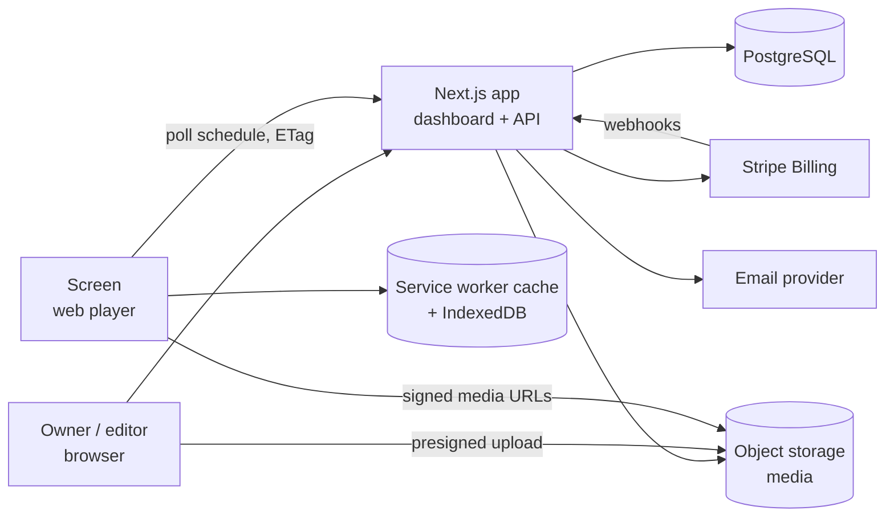
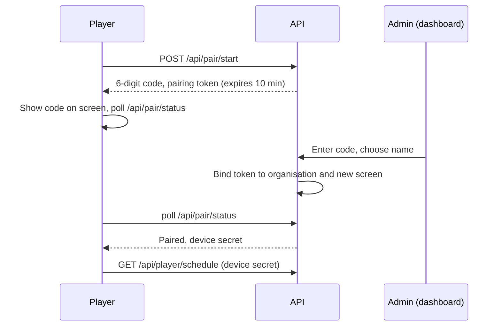
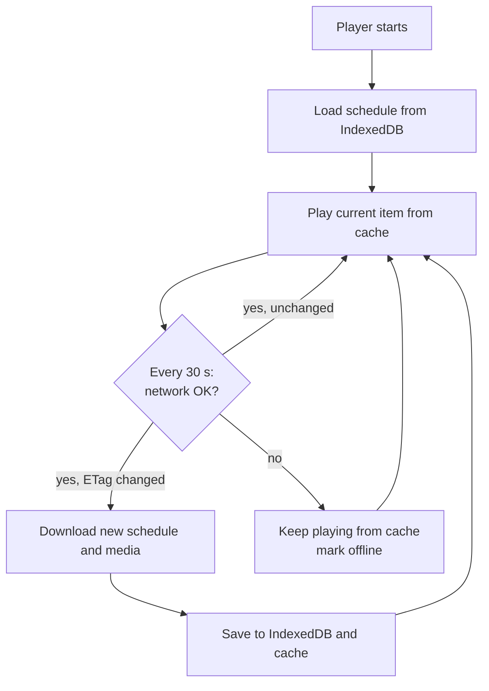
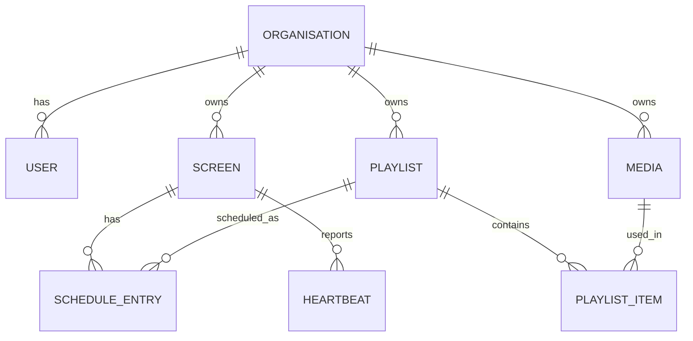

# Diagrams

> **Example content** for the made-up SignalDeck project. Step 1 replaces it.

Text diagrams (Mermaid), so they diff and stay editable in the repo. Scope follows `mission.md`.

# System overview



# Screen pairing (FR-6)



# Playback loop and offline behaviour (FR-7, NFR-1, NFR-2)



# Data model



# Build timeline

```text
Phase 1   2          3        4             5            6        7        8
Skeleton  Auth +     Media    Playlists +   Pairing +    Status + Billing  Hardening
          tenancy    library  schedules     player       logs              + release notes
```
